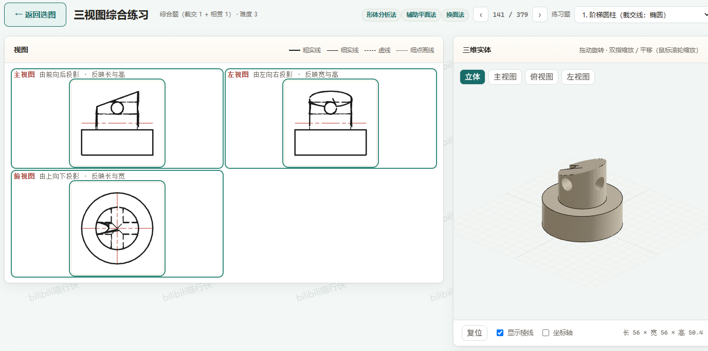
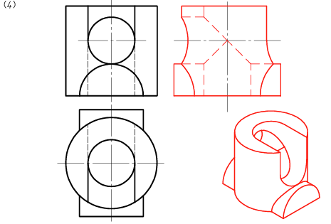
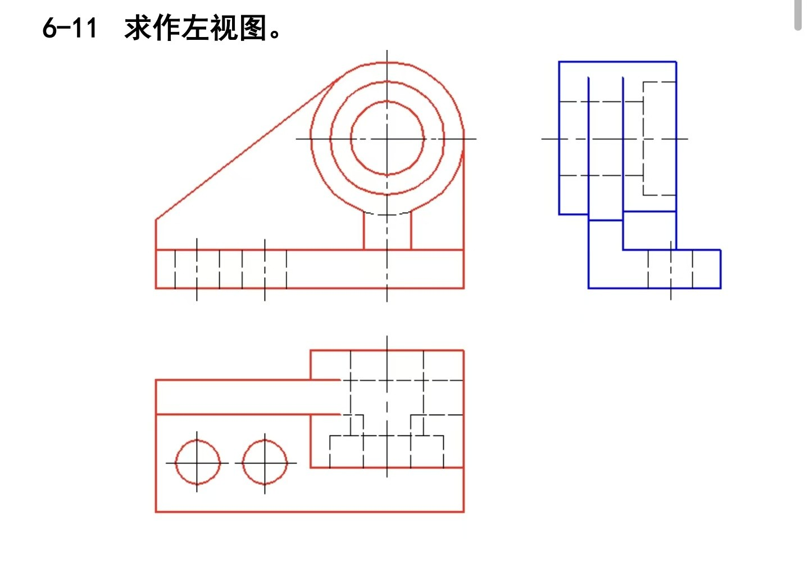

# 三视图工坊 · Three View Studio

面向工程制图初学者的离线学习网站，借助 AI 辅助开发。上传题图、框选已知视图，或在 379 道内置练习中选题；一边分步作图，一边旋转零件，对照实线和虚线分别对应哪些棱边。

**[Windows 10 / 11（64 位）免安装包：三视图文档.zip](downloads/三视图文档.zip)** · [例题示意](#例题示意) · [从源码运行](#从源码运行)

## 下载与启动

1. 下载上方的免安装包。如果 GitHub 打开的是文件页，点击右上角的下载图标（Download raw file）。
2. 右键压缩包，选择「全部解压」，再双击解压目录里的 **启动网站.cmd**。不需要另装 Node.js。
3. 浏览器会自动打开网站。使用时保持启动窗口打开；如果浏览器没有打开，复制窗口里显示的地址即可。

## 界面预览



上图截自内置练习。观察斜切面时，可以先看主视图中斜边两端的高度，再旋转右侧实体，对照俯视图中的轮廓。

## 例题示意

| 开槽圆管：对照三视图与立体示意 | 支座：由主视图和俯视图补左视图 |
| --- | --- |
|  |  |

这两张是带参考画线的原题图。练习上传时，只框题目给出的视图，留出待求视图。例如右图应选「补左视图」，框选左上和左下两幅，不把右侧蓝色参考答案框进去。遇到孔深或内部结构不能由已知线唯一确定时，应回看虚线、尺寸或剖视条件。

## 从源码运行

安装 Node.js 24 后，在仓库根目录执行：

```sh
npm ci
npm start
```

打开 <http://127.0.0.1:5178/>。依赖首次安装需要联网；运行时的识别、绘图和建模均在本机完成。运行 `npm test` 可检查题库和几何逻辑；服务启动后，运行 `npm run test:site` 可检查网站资源和接口。

前端位于 `public/`：原生 JavaScript 和 Canvas 提取图线，SVG 展示分步作图，Three.js 构建和显示实体。后端入口是 `server.js`，通过 Express 提供网站和接口，用 Node.js 内置 SQLite 将学习记录存放在本机。
